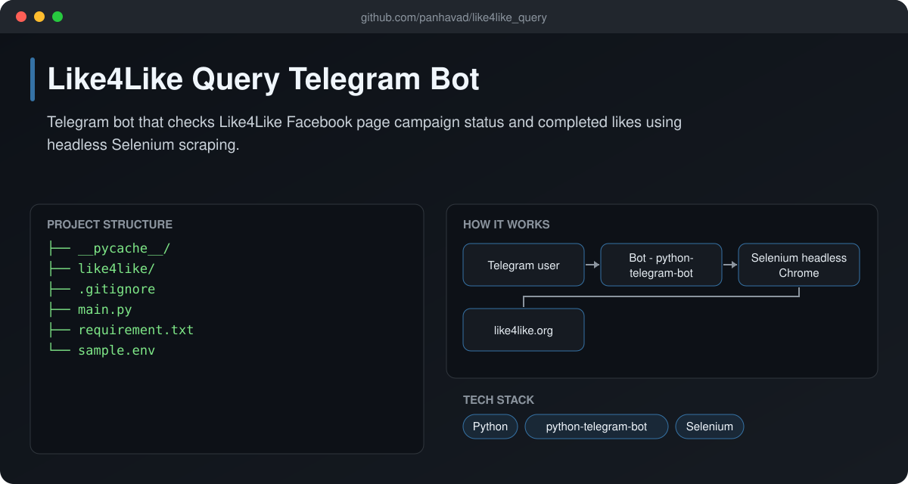
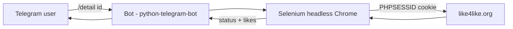

# Like4Like Query Telegram Bot

  [](https://github.com/panhavad/like4like_query/releases/latest)

A **Telegram bot** that reports the status of your **Like4Like** Facebook page campaigns. Send `/detail <page_id>` and the bot logs in with a headless Chrome session, reads the campaign table and replies with the current status and completed likes.



## Features

- `/detail <page_id>` command
- Headless Selenium + webdriver-manager
- Session cookie login (no password stored)
- Request logging to `stat.log`

## How it works



## Getting started

```bash
pip install -r requirement.txt
cp sample.env .env   # set TELEGRAM_BOT_TOKEN and SESS_ID
python main.py
```

## Download

Grab the packaged source from the [latest release](https://github.com/panhavad/like4like_query/releases/latest).

## Tech stack

- Python
- python-telegram-bot
- Selenium

## Project structure

```text
like4like_query/
├── __pycache__/
├── docs/
├── like4like/
├── .gitignore
├── main.py
├── README.md
├── requirement.txt
└── sample.env
```
